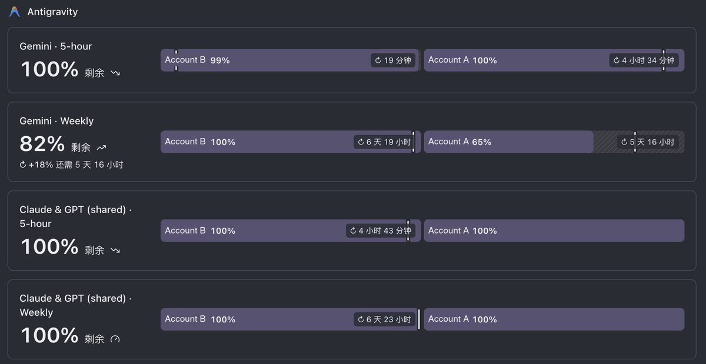

[简体中文](README.md) | **English**

# Antigravity usage via CLI

Reads Antigravity limits for T3's usage panel with the official CLI's `/usage` command. Each T3 Antigravity instance uses its own sign-in; the command sends no message and spends no tokens. T3 stops reading your token file and calling Google's internal API with a spoofed client header.



An extension for [T3 Code Extensions](https://github.com/ZiHao256/t3code-extensions), an unofficial extension host for [T3 Code](https://github.com/pingdotgg/t3code).

## Install with an agent

Paste this to Claude Code, Codex or another coding agent:

```text
Install the T3 Code extension "Antigravity usage via CLI" (https://github.com/ZiHao256/t3x-agy-usage) on this Mac.
1. Check that T3 Code Extensions is installed (v0.2.0 or later: `node install.cjs status` in its checkout must say it is installed for T3 Code 0.1.12). If it isn't, install it first by following the "Install with an agent" section of https://github.com/ZiHao256/t3code-extensions/blob/main/README.en.md, and ask me before quitting T3 Code.
2. Open ~/Applications/T3 Code Extensions.app, go to Settings → Extensions → Browse, and install "t3x-agy-usage" from the community list, or paste https://github.com/ZiHao256/t3x-agy-usage into the link field and click Add. In the confirmation dialog, check that the source is ZiHao256/t3x-agy-usage before confirming. It runs in T3's background, so the dialog notes background permission; that is expected.
3. In the Installed tab, make sure it is enabled and tell me its version.
If you can't operate the app's UI, do step 1, then tell me exactly what to click for steps 2 and 3.
```

## How it works

- A background extension (`apiVersion` 4, `permissions: ["server"]`): it runs inside T3's backend with your user permissions.
- For each instance it runs the CLI that T3 resolved for that instance: `<cli> -p /usage --output-format json --print-timeout 20s`. `HOME` points to a per-instance shadow folder whose `.gemini/antigravity-cli` links to T3's sign-in folder for that instance, so every instance reads its own account. Variables that switch the sign-in method (`GEMINI_API_KEY`, `GOOGLE_*`, …) are removed; auto-update and the browser are disabled.
- The instance's MCP config is not linked: otherwise the CLI starts every configured MCP server on each read.
- Safeguards against `/usage` being sent to the model: CLI older than 1.1.11 is refused (the version is rechecked whenever the CLI file changes); a result counts only if it is the `usage` command with 0 turns and every token count 0; until a CLI has passed once, only one read runs at a time; if a read may have spent tokens, that CLI is not run again until the extension is re-enabled or the CLI changes. These limit the damage to at most one message, they can't make it impossible.
- It has no timer of its own: it reads whenever T3 would read Antigravity limits itself, mainly on T3's provider health checks (Settings → Providers → Advanced → Health check interval; 0 turns the periodic checks off) and when you open the usage panel.
- Results (and errors) are reused for 60 seconds per instance, unless the sign-in file changes; concurrent reads share one run. Each run takes about 6–9 seconds; a run that doesn't finish in 45 seconds is killed.
- While enabled, T3's own Antigravity reading is not used, not even as a fallback. Disable or uninstall the extension to get it back.

Only instances signed in with Google (`oauth-*`) are handled; others keep T3's behavior. The CLI is told to read the sign-in file in the instance folder, so a business sign-in kept only in the system keychain shows as signed out.

## Development

- `npm test` runs the tests (Node 22+, no dependencies; a fake CLI, no network).
- To try changes: Settings → Extensions → Add local extension, pick this folder, then click refresh on its card after each edit.

## License

MIT
