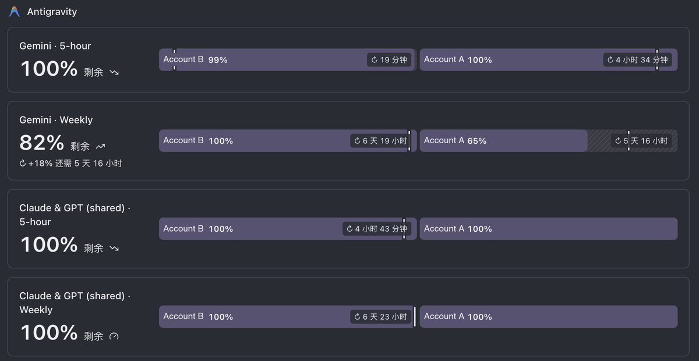

# Antigravity usage via CLI（Antigravity 官方额度）

Reads Antigravity limits for T3's usage panel with the official CLI's `/usage` command. Each T3 Antigravity instance uses its own sign-in; the command sends no message and spends no tokens. T3 stops reading your token file and calling Google's internal API with a spoofed client header.

T3 额度面板里的 Antigravity 额度改由官方 CLI 的 `/usage` 读取：每个 T3 Antigravity 实例用自己的登录，不发消息、不耗 token。T3 不再自己读 token 文件、冒充客户端去调 Google 的内部接口。



An extension for [T3 Code Extensions](https://github.com/ZiHao256/t3code-extensions), an unofficial extension host for [T3 Code](https://github.com/pingdotgg/t3code).

[T3 Code Extensions](https://github.com/ZiHao256/t3code-extensions) 的扩展。

## Install with an agent / 让 agent 安装

Paste this to Claude Code, Codex or another coding agent. 把下面的提示词发给 Claude Code、Codex 等 coding agent。

```text
Install the T3 Code extension "Antigravity usage via CLI" (https://github.com/ZiHao256/t3x-agy-usage) on this Mac.
1. Check that T3 Code Extensions is installed (v0.2.0 or later: `node install.cjs status` in its checkout must say it is installed for T3 Code 0.1.12). If it isn't, install it first by following the "Install with an agent" section of https://github.com/ZiHao256/t3code-extensions, and ask me before quitting T3 Code.
2. Open ~/Applications/T3 Code Extensions.app, go to Settings → Extensions → Browse, and install "t3x-agy-usage" from the community list, or paste https://github.com/ZiHao256/t3x-agy-usage into the link field and click Add. In the confirmation dialog, check that the source is ZiHao256/t3x-agy-usage before confirming. It runs in T3's background, so the dialog notes background permission; that is expected.
3. In the Installed tab, make sure it is enabled and tell me its version.
If you can't operate the app's UI, do step 1, then tell me exactly what to click for steps 2 and 3.
```

```text
帮我在这台 Mac 上给 T3 Code 装「Antigravity 官方额度」扩展（https://github.com/ZiHao256/t3x-agy-usage）。
1. 确认已安装 T3 Code Extensions（需要 v0.2.0 及以上：在它的仓库目录里运行 `node install.cjs status`，要显示已安装、基于 T3 Code 0.1.12）。没装的话，先按 https://github.com/ZiHao256/t3code-extensions 里「让 agent 安装」一节装好；要退出 T3 Code 前先问我。
2. 打开 ~/Applications/T3 Code Extensions.app，进入 设置 → 扩展 →「浏览」，在社区扩展里安装 t3x-agy-usage；或者把 https://github.com/ZiHao256/t3x-agy-usage 粘贴到链接框里点「添加」。确认框里核对来源是 ZiHao256/t3x-agy-usage 再确认。这是后台扩展，确认框里会提示「后台」权限，属正常。
3. 在「已安装」里确认它已启用，告诉我版本号。
如果你没法操作应用界面，做完第 1 步后，把第 2、3 步具体点哪里告诉我。
```

## How it works / 原理

- A background extension (`apiVersion` 4, `permissions: ["server"]`): it runs inside T3's backend with your user permissions. 后台扩展：在 T3 后台里以你的用户权限运行。
- For each instance it runs the CLI that T3 resolved for that instance: `<cli> -p /usage --output-format json --print-timeout 20s`. `HOME` points to a per-instance shadow folder whose `.gemini/antigravity-cli` links to T3's sign-in folder for that instance, so every instance reads its own account. Variables that switch the sign-in method (`GEMINI_API_KEY`, `GOOGLE_*`, …) are removed; auto-update and the browser are disabled. 每个实例跑一次 T3 给它解析出的 CLI；`HOME` 指向影子目录，里面的 `.gemini/antigravity-cli` 链到 T3 给这个实例的登录目录，所以各实例读各自的账号。会切换登录方式的环境变量被去掉，自动更新和浏览器都关掉。
- The instance's MCP config is not linked: otherwise the CLI starts every configured MCP server on each read. 不链接实例的 MCP 配置，否则每次读取 CLI 都会把配置的 MCP 服务器全部拉起来。
- Safeguards against `/usage` being sent to the model: CLI older than 1.1.11 is refused (the version is rechecked whenever the CLI file changes); a result counts only if it is the `usage` command with 0 turns and every token count 0; until a CLI has passed once, only one read runs at a time; if a read may have spent tokens, that CLI is not run again until the extension is re-enabled or the CLI changes. These limit the damage to at most one message, they can't make it impossible. 防止 `/usage` 被当成对话发出去：低于 1.1.11 的 CLI 不运行（CLI 文件一变就重新查版本）；只接受 `usage` 命令、0 轮、各项 token 都是 0 的结果；一个 CLI 通过一次之前同时只跑一个；一旦可能有消耗，重新启用扩展或换 CLI 之前不再运行它。这些措施把最坏情况限制在一条消息，不能保证绝对不会发生。
- It has no timer of its own: it reads whenever T3 would read Antigravity limits itself, mainly on T3's provider health checks (Settings → Providers → Advanced → Health check interval; 0 turns the periodic checks off) and when you open the usage panel. 扩展自己没有定时器，T3 什么时候读 Antigravity 额度它就什么时候读：主要是 T3 的提供方健康检查（设置 → 智能体提供方 → 高级 → 健康检查间隔，设成 0 就不定时检查）和打开用量面板的时候。
- Results (and errors) are reused for 60 seconds per instance, unless the sign-in file changes; concurrent reads share one run. Each run takes about 6–9 seconds; a run that doesn't finish in 45 seconds is killed. 每个实例的结果（包括错误）复用 60 秒，登录文件变了就重新读；并发读取合并成一次。每次大约 6–9 秒，45 秒没结束就终止。
- While enabled, T3's own Antigravity reading is not used, not even as a fallback. Disable or uninstall the extension to get it back. 启用期间不用 T3 自己的读取方式，出错也不退回；停用或卸载扩展就恢复。

Only instances signed in with Google (`oauth-*`) are handled; others keep T3's behavior. The CLI is told to read the sign-in file in the instance folder, so a business sign-in kept only in the system keychain shows as signed out. 只接手用 Google 登录（`oauth-*`）的实例，其他照旧。CLI 只读实例目录里的登录文件，只存在系统钥匙串里的企业账号登录会显示为未登录。

## Development / 开发

- `npm test` runs the tests (Node 22+, no dependencies; a fake CLI, no network). 运行测试，用假的 CLI，不联网。
- To try changes: Settings → Extensions → Add local extension, pick this folder, then click refresh on its card after each edit. 试改动：设置 → 扩展 →“添加本地扩展”选本目录，改完点卡片上的刷新。

## License

MIT
